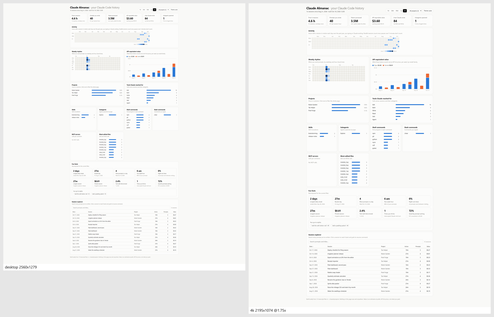
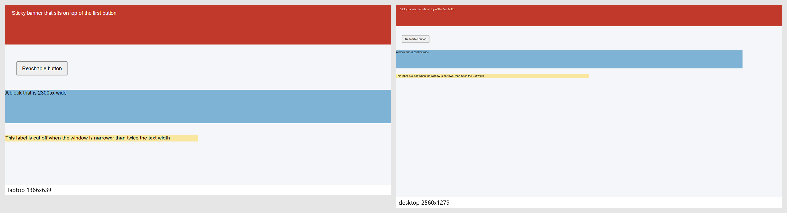

# Eyes

A command-line tool that lets Claude Code look at, and play, what it builds before it says it is
done. It opens a web page (or runs a Godot game scene) at real screen sizes, uses real mouse and
keyboard input, collects every console error and failed request, and hands back one short text report
plus one image Claude can read in a single step.



## The problem

Claude Code is good at code and bad at knowing whether the result looks right. A project can show
hundreds of green tests while the page overflows the screen, a button hides under a banner, or the
game's combat does nothing the first time someone plays it. Without a way to look, the person ends up
being Claude's eyes, pasting screenshots into the chat. Eyes gives Claude the look first.

Here is its report on a deliberately flawed test page (`test/fixtures/overflow.html`), at a laptop
screen and a wide desktop screen:

```
FAIL overflow (laptop, desktop)
layout [laptop] hscroll #wide: page 2300px wide in a 1366px window
layout [laptop] offscreen #covered: covered at its centre by #banner
layout [laptop] textOverflow #label: content 1200px wide in a 683px box with overflow hidden
layout [desktop] offscreen #covered: covered at its centre by #banner
Read: .eyes/runs/20261023-082622-overflow/sheet.png
```



## What it does

- **`eyes look <url or file>`** screenshots a page at each display profile and reports page errors,
  console errors, failed requests and layout problems (horizontal scroll, elements covered or cut off
  by the viewport, text overflowing its box).
- **`eyes run <scenario>`** runs a scripted scenario: real clicks, drags, key presses and typing,
  waits, named screenshots and checks on what a player would notice. Exit code 0 only if every check
  passed and nothing threw.
- **`eyes diff <scenario>`** compares named screenshots with approved baselines and writes a
  before, after and highlighted-difference image for each view that changed. A person approves new
  baselines with `eyes accept`, and `accept` refuses to run inside Claude Code.
- **`eyes film <url or scenario>`** records frames at a fixed rate under a controlled clock and makes a
  GIF, a contact sheet and a flicker score, to judge animation and shimmer.
- **`eyes serve "<command with {port}>"`** starts a dev server on a free port and waits until it
  answers (scenarios use this with `serve:`).
- **Godot scenes** run through Godot's movie writer with scripted input at a fixed frame rate, with
  checks evaluated against the live scene.
- **Touch views** emulate a phone or iPad, so the page sees `pointer: coarse` and `hover: none`.
- **Repeatable by design:** a fixed clock, frozen animations and seeded `Math.random` mean the same
  scenario gives the same pictures on unchanged code. No fixed sleeps; it waits for the page to be
  ready.

Exit codes: 0 passed, 1 a check, error, layout or diff failed, 2 bad usage, 3 the environment failed
(Chromium or the dev server died, not the page).

## Install

You need Node 22 or newer. From a clone of this repo:

```
node install.mjs
```

This installs Eyes into `~/.claude/tools/eyes` (outside `AppData`, so the Claude desktop app's
sandbox cannot hide it), runs `npm ci`, downloads Playwright's Chromium into that folder, writes
`eyes` (bash) and `eyes.cmd` (cmd, PowerShell) wrappers, and copies the skill in `skill/SKILL.md` to
`~/.claude/skills/eyes/` so Claude learns when and how to use the tool. Then:

```
~/.claude/tools/eyes/eyes look path/to/page.html
```

Options: `--target <dir>`, `--skills-dir <dir>`, `--skip-browsers`, `--uninstall`. Re-running is safe,
even while other Claude sessions are mid-run: the new copy is built in a staging folder and swapped in
only when it has fully worked, so a failed install leaves the old one working. It refuses to touch a
non-empty folder it did not create (it leaves a `.eyes-install.json` marker), or any folder inside or
holding this checkout.

## Screen sizes are examples

The built-in `desktop` (2560x1440 at 100%) and `4k` (2194x1234 CSS pixels at 175% scaling) profiles
are my two monitors, and they are the default views. They are only a starting point:

- `eyes calibrate` prints a link. Open it in a maximised Chrome at 100% zoom on each of your monitors
  and press the matching button; the exact window size and scale are stored in
  `~/.claude/tools/eyes/profiles.json` and replace the built-in numbers for that name. Set
  `EYES_CALIBRATION=<file>` to read and write a different file.
- You can add a profile of your own, such as a fixed 1920x1080 game canvas, by writing an entry
  with a new name (`width`, `height`, `deviceScaleFactor`) into that file.
- `laptop` (1366x768) is built in as a small-screen check.
- Touch profiles: `phone` 360x780 at 3x, `phone-l` 430x932 at 3x, `ipad-mini` and `ipad-13` in
  portrait and landscape (`-side`).

## Godot

A Godot scenario names the Godot console executable and the project. The path below is an example;
use wherever Godot lives on your machine, or set the `EYES_GODOT` environment variable instead.

```yaml
kind: godot
godot: { exe: C:/Godot/godot_console.exe, project: C:/path/to/game, scene: res://main.tscn, frames: 120, fps: 30, resolution: 1920x1080 }
steps:
  - { at: 10, press: ui_accept }
  - { at: 60, shot: mid-fight }
  - { at: 119, check: "$Player.position.x > 100" }
```

Each run gets its own empty user-data folder, so it never touches real save files. Inputs reach
physics one frame after the frame they are scheduled on. Gamepads, wall-clock ticks and `randomize()`
are not controlled. The full scenario formats, for web and Godot, are in `skill/SKILL.md`.

## Tests

```
npm ci
npm test
```

252 tests on Node's built-in test runner. Many drive real Chromium against small fixture pages that
each misbehave in one way (an overflow, a flicker, a page that is never ready, a page that draws at
random), and the Godot tests check, among other things, that two runs of the same scenario give the
same frame. The suite sets `EYES_CALIBRATION` to a path that does not exist, so it never reads or
writes your real calibration. The Godot tests need a Godot console exe (see above) and are skipped
without one; the install tests run `npm ci` into a temporary folder.

## How it works

Eyes is a Node command-line tool plus a skill, not a server, so it works the same from a main
session, a subagent or an unattended run. Each run writes a folder under `.eyes/runs/`: the text
report (at most 40 lines), the full results as JSON, and the images. The skill in `skill/SKILL.md`
tells Claude when to run it and how to read what comes back; the images are plain PNG and GIF files
that Claude opens with its Read tool.

- **Browser.** Playwright drives Chromium. Eyes starts it headless and reads the WebGL renderer; if
  headless only has software rendering, it relaunches as a real window parked off screen so pages
  render on the GPU. If Chromium dies under a profile, that profile runs once more in a fresh
  browser, and a second death is reported as an environment failure (exit 3), not a page failure.
- **Real input.** Clicks, drags, key presses and typing go through Playwright's mouse, keyboard and
  touchscreen, which send trusted browser events, the same ones a person's hardware produces.
- **Ready without sleeps.** A page is ready after load, web fonts, two animation frames, an optional
  selector, the page's own `window.__eyes.ready` flag if it sets one, and a best-effort quiet
  network. Every wait, step and in-page script is raced against a deadline, because a page can keep a
  promise pending forever.
- **Layout checks** run inside the page in a single pass: page width against the window,
  `elementFromPoint` at the centre of each control to find what covers it, and text wider than a box
  that clips it. Each finding names the element by its shortest unique CSS selector.
- **Determinism.** With `clock: fixed`, Playwright's clock is paused at a fixed instant before the
  page runs, `Math.random` becomes a seeded mulberry32 generator, and the document's animation
  timeline is frozen through the Chrome DevTools Protocol. Time then moves only on `advance` steps,
  which move the clock and every running CSS or Web animation by the same amount.
- **Images and baselines.** `sharp` builds the contact sheets, before/after/difference strips and
  GIFs, downscaling tiles and drawing labels as SVG so one image stays legible. `pixelmatch` compares
  shots with baselines, after painting masked regions a flat colour. `eyes diff --update` only
  proposes new baselines in a pending folder; `eyes accept` moves them into place and refuses to run
  when it sees Claude Code's environment variables.
- **Flicker score.** Filmed frames are cut into tiles of about 64x64 pixels. A pixel counts only if
  it flips back and forth over four frames in a row, which smooth or fast motion never does, and the
  score is the worst tile's, so a small shimmering element still shows on a large page.
- **Godot.** A GDScript driver (`godot/eyes_driver.gd`) runs inside Godot with the movie writer on,
  which locks the timestep to 1/fps and saves every frame. The driver fires each input on its
  frame, puts held input back if the window loses focus, evaluates the checks against the live scene
  and writes the results as JSON for Eyes to turn into the report.
- **Dev servers.** `eyes serve` picks a free port, polls until the server answers, and kills the
  whole process tree on exit, Ctrl-C or a crash.

Built with Claude Code.

## License

MIT, see [LICENSE](LICENSE).
